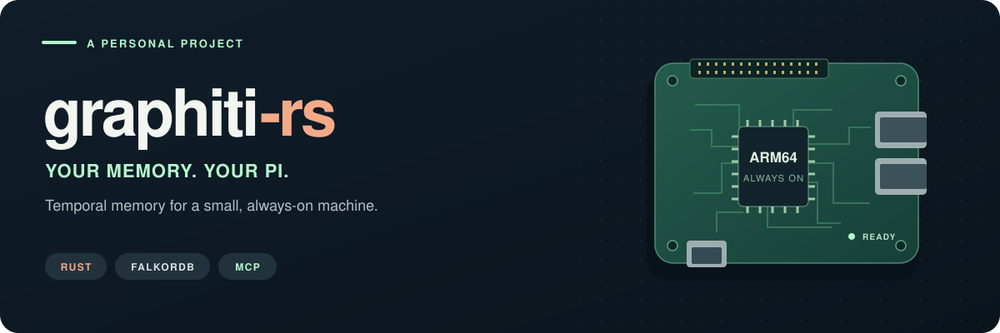

<p align="center">
  
</p>

<p align="center">
  <a href="https://github.com/andyjusa/graphiti-rs/actions/workflows/ci.yml"></a>
  <a href="Cargo.toml"></a>
  <a href="docs/compat/pi-results.md"></a>
  <a href="LICENSE"></a>
</p>

<p align="center">
  <strong>Your own graph memory server, running on a Raspberry Pi.</strong><br>
  Rust · FalkorDB · MCP · Optional local embeddings
</p>

<p align="center">
  <a href="#quick-start">Quick start</a> ·
  <a href="#how-it-compares-to-graphiti">Compare with Graphiti</a> ·
  <a href="#raspberry-pi-measurements">Pi measurements</a> ·
  <a href="docs/standalone-guide.md">Configuration &amp; API guide</a>
</p>

## Built for a small, always-on server

**graphiti-rs is a personal project with one goal: run a Graphiti memory server on my Raspberry Pi.**
It is an independent Rust implementation inspired by [getzep/graphiti](https://github.com/getzep/graphiti)'s temporal graph memory design. The deployment centers on one Rust server process and FalkorDB, with explicit limits on concurrent work, search candidates and request duration.

It connects entities and facts to their source episodes, retaining history and provenance as facts change. MCP clients can store and retrieve memories over stdio or Streamable HTTP. Automatic extraction uses an OpenAI-compatible API; embeddings can come from an external API or optional local CPU inference. Supply structured extraction directly to get started without a model API.

> [!NOTE]
> This is a personal, independent implementation, not an official Rust edition of Graphiti. It does not promise complete Python API, database backend or latest MCP feature parity. For existing Graphiti data, see **compatibility mode** below.

## Raspberry Pi measurements

<!-- PAIRED_BENCHMARK -->
**About 89% less server memory on the same Pi4: Python 118.31 MiB → Rust 13.16 MiB RSS.**

On October 15, 2026, we compared the preserved **Graphiti 0.28.2 MCP server** with the **deployed Rust compatibility release `8df9904`** on a physical Raspberry Pi4. Both used the same database, 1,200 synthetic facts, 3072-dimensional mock embeddings and one-CPU quota, across three rounds with alternating execution order. No benchmark ran on a Mac.

| Measurement | Python Graphiti + MCP | graphiti-rs compatibility mode |
| --- | ---: | ---: |
| Server RSS after reads/searches · median of 3 rounds | 118.31 MiB | **13.16 MiB** |
| Server process peak RSS · maximum of 3 rounds | 118.32 MiB | **13.58 MiB** |
| Server CPU time · median per 300 requests | 28.33 s | **2.09 s** |
| Episode read p50 | 24.12 ms | **2.62 ms** |
| Hybrid fact search p50 | 152.90 ms | **48.07 ms** |
| Semantic node search p50 | 123.72 ms | **26.14 ms** |

Latency figures are the medians of the three per-round p50s, each based on 100 requests. Ten warmups per workload are excluded. **All 1,800 measured requests succeeded**, with matching hashes of complete tool responses after timestamp normalization.

**These memory figures cover the server process only.** FalkorDB separately used about 71.8–75.9 MiB RSS at the end of each run. This does not measure model inference, ingestion throughput or Python 0.31 memory, and does not imply an 89% reduction for the whole system including the database and models.

[Conditions, per-round ranges & reproduction](docs/benchmarks/pi-paired-20261015.md) · [Raw measurements](docs/benchmarks/pi-paired-20261015.json) · [Summary & source hashes](docs/benchmarks/pi-paired-20261015-summary.json)
<!-- /PAIRED_BENCHMARK -->

Further Rust tuning on October 16 reduced median **server CPU by 6.6%** against deployed main `c1b501c`: 2.11 → 1.97 seconds per 300 synthetic retrieval requests, with server memory essentially unchanged. Redundant Redis read checks and property-map copies were removed. This is a separate Rust/Rust cohort; [results, ranges and rejected candidates](docs/benchmarks/pi-rust-20261016.md) preserve the full evidence. The measured candidate is `0ef0893`; the operating deployment remains `c1b501c`.

Earlier evidence includes [Pi4 ARM64 validation](docs/compat/pi-results.md), [vector retrieval measurements](docs/compat/vector-retrieval.md) and the [operating cutover record](docs/compat/operational-cutover-20261003.md). Those runs used different datasets and modes; distinguish server RSS from total memory including FalkorDB and models.

## How it compares to Graphiti

The feature comparison uses [Graphiti 0.31.0 source](https://github.com/getzep/graphiti/tree/aca369364226a666ca541b061ff2a1a54b80f2ff). This project focuses on **the memory server I need on a Pi**, with a smaller scope than the upstream framework.

| | Graphiti · Python | graphiti-rs · Rust |
| --- | --- | --- |
| Goal | General framework and SDK for temporal knowledge graphs | Personal Raspberry Pi memory and MCP server |
| Runtime | Python 3.10+ and selected database/model providers | Compiled Rust server and FalkorDB; no Python server runtime |
| Graph storage | Multiple backends, including Neo4j, FalkorDB and Neptune | Focused on FalkorDB |
| Scope | Custom types, communities and a broad range of retrieval/model configurations | Episodes, entities, facts, validity windows and provenance, with bounded retrieval and ingestion |
| Models | External providers and optional local model integrations | External OpenAI-compatible APIs; local embeddings are an optional build feature |
| Compatibility | Upstream Python and MCP contracts | Six standalone tools by default; an optional profile for ten observed 0.28.2 MCP tools |

Python's local model dependencies are optional too. See the [matched Pi measurements](#raspberry-pi-measurements) above for memory, CPU and latency. Selected upstream correctness fixes have been backported; the [comparison report](docs/compat/upstream-main-20261015.md) records those changes and deliberate differences.

## Two operating modes

| | Standalone · default | Graphiti compatibility · optional |
| --- | --- | --- |
| Purpose | Start a new memory store | Integrate with the observed existing Graphiti deployment |
| Build | Default build; optionally `local-embeddings` | `--features graphiti-compat` |
| Storage format | Own schema and a separate graph name | Observed Graphiti 0.28.2 schema |
| MCP | Six tools | Ten recorded tools |
| Writes and models | Explicit extraction or external API; optional embeddings | Read-only by default; operational writes require the verified providers, 3072-dimensional profile and durable journal |

The six standalone tools are `add_episode`, `search_facts`, `search_nodes`, `get_episode`, `delete_episode` and `get_status`. Arguments and temporal/deletion semantics are documented in the [API guide](docs/standalone-guide.md#mcp-tools). The standalone server's single token grants access to every group; group IDs are not a per-user authorization boundary.

Compatibility mode covers a selected Graphiti profile, not every feature in the latest upstream. It also preserves the existing embedding space rather than switching it to a local model. Review the [compatibility scope](docs/compat/implementation.md), [operational configuration](docs/compat/operational-mode.md) and [Pi cutover record](docs/compat/operational-cutover-20261003.md) first.

## Quick start

This **standalone-mode** example creates a new store. It requires Docker Compose and Python 3 for the demo client.

```sh
git clone https://github.com/andyjusa/graphiti-rs.git
cd graphiti-rs
cp .env.example .env
# Set GRAPHITI_TOKEN in .env to a long, random value.
docker compose up -d --build

# Use the same token you set in .env.
export GRAPHITI_TOKEN='your-token-from-.env'
python3 examples/demo.py
```

Compose exposes `127.0.0.1:8080/mcp` and a local FalkorDB, stores database data in a named volume and enables AOF persistence. The demo uses explicit extraction with embeddings disabled, so it needs no paid model API. The server itself needs no Python runtime.

To use an existing FalkorDB, start with **a different graph name from Python Graphiti**:

```sh
cargo build --release --locked
export FALKORDB_URL=redis://127.0.0.1:6379
export GRAPHITI_GRAPH=graphiti_rs
./target/release/graphiti-rs --transport stdio
# For HTTP, use: --transport http
```

The binary does not load `.env` automatically. See the [operations and resource guide](docs/standalone-guide.md#resource-defaults) for HTTP authentication, reverse proxies, work limits and TLS. Rust 1.95 is tested; the manifest's minimum version, 1.88, has not been separately verified.

### Local embeddings when you need them

The default build includes no Candle or tokenizer dependencies. To enable local embeddings, prepare the model first and opt into the feature:

```sh
python3 scripts/download-minilm.py
cargo build --release --locked --features local-embeddings
export EMBEDDING_PROVIDER=local
export EMBEDDING_MODEL=sentence-transformers/all-MiniLM-L6-v2
export EMBEDDING_DIM=384
export LOCAL_MODEL_DIR="$PWD/models/minilm"
./target/release/graphiti-rs --transport stdio
```

One CPU worker runs inference sequentially; the running server never downloads weights. The example MiniLM is an English model. Validate a suitable multilingual model separately for Korean. Model format, per-group embedding identity and Compose configuration are covered in the [local embedding guide](docs/standalone-guide.md#optional-local-embeddings).

## Verification and documentation

Isolated ARM64 Pi tests and real local CPU embedding inference have passed. Existing-data cutover and restart results are recorded for the separate compatibility profile. CI covers optional local inference and Linux ARM64 builds. ARMv7, general model quality and complete upstream feature parity are outside this verification scope.

| Document | Contents |
| --- | --- |
| [Standalone server guide](docs/standalone-guide.md) | Full configuration, six-tool API, temporal/deletion contracts, embeddings, resource bounds and check commands |
| [Compatibility implementation](docs/compat/implementation.md) · [Operational configuration](docs/compat/operational-mode.md) | Ten-tool profile, legacy schema, permissions, provider and journal requirements |
| [Upstream comparison](docs/compat/upstream-main-20261015.md) | Selected 0.31.0 backports and excluded scope |
| [Verification record](docs/verification.md) · [Pi evidence](docs/compat/pi-results.md) | Observed results and verification limits |

## License and credits

[Apache-2.0](LICENSE). Thanks to [Graphiti](https://github.com/getzep/graphiti) for its design and open implementation. This repository is an independent Rust implementation; upstream material included in the compatibility feature, such as prompts, is credited in the [attribution notice](tests/fixtures/python-0282/NOTICE). Downloaded models retain their own licenses and are excluded from Git.
